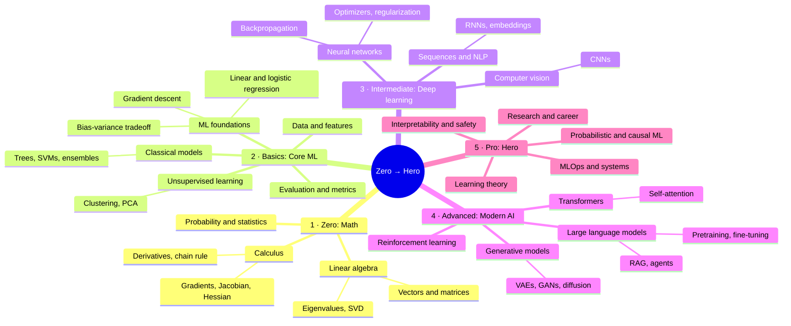

# 👋 ML Zero to Hero

**Everyone in the world should be able to learn computer science, for free.** We're starting with machine learning, taking you from zero to hero, one concept at a time.

📺 **YouTube:** [youtube.com/@mlzerotoherousa](https://www.youtube.com/@mlzerotoherousa): a new video every 12 hours, 8 AM and 8 PM Pacific.

### Every video
🧠 intuition first → 🎞️ animated graphics → 🔢 a tiny worked example → ∑ the math, symbol by symbol → ✅ a quick check

### The learning path

### Code for every video
Each video has a folder with runnable Python and the notes behind it:

| Topic | Repo |
|---|---|
| Math foundations (linear algebra, calculus, probability, optimization) | [math-foundations](https://github.com/mlzerotoheroyoutube/math-foundations) |
| ML foundations | [ml-foundations](https://github.com/mlzerotoheroyoutube/ml-foundations) |
| Classical supervised learning | [classical-supervised-learning](https://github.com/mlzerotoheroyoutube/classical-supervised-learning) |
| Deep learning foundations | [deep-learning-foundations](https://github.com/mlzerotoheroyoutube/deep-learning-foundations) |
| Computer vision | [computer-vision](https://github.com/mlzerotoheroyoutube/computer-vision) |
| Transformers | [transformers](https://github.com/mlzerotoheroyoutube/transformers) |
| Large language models | [large-language-models](https://github.com/mlzerotoheroyoutube/large-language-models) |
| Generative models | [generative-models](https://github.com/mlzerotoheroyoutube/generative-models) |

### Contributing
Found a mistake in a video or its code? Open an issue on the topic repo above.

Made in San Francisco. Topic requests welcome: open an issue.
